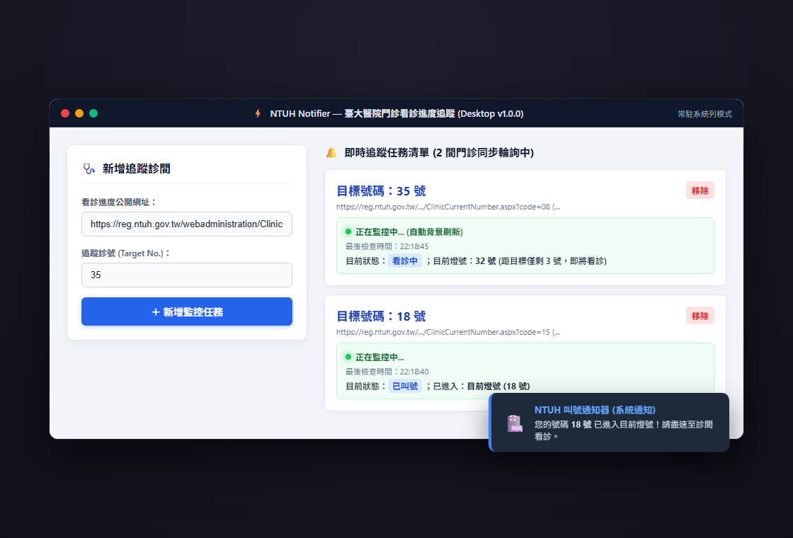

# NTUHNotifier2

Windows 臺大醫院門診叫號通知器，接近或到號時提醒

Track NTUH outpatient queues on Windows and receive alerts near or at your number.



[中文](#中文) · [English](#english)

## 中文

以 Electron 與 React 製作的桌面程式，供臨床研究助理與其他等待臺大醫院門診叫號的人追蹤號碼。

### 安裝與執行

準備 Windows、Node.js 與 npm。鎖定的 Vite 套件要求 Node.js `^20.19.0 || >=22.12.0`。下載並解壓縮原始碼後，在終端機執行：

```powershell
cd NTUHNotifier2
npm install
npm run electron:start
```

`npm run electron:start` 會啟動 Vite 與 Electron。若只開發網頁介面，可執行 `npm run dev` 啟動 Vite。

在 Windows 建置 MSI 安裝套件的指令為：

```powershell
npm run electron:build
```

此指令先執行 `npm run build`，進行 TypeScript 檢查與 Vite 建置，再由 electron-builder 封裝 MSI，輸出至 `%TEMP%\ntuhnotifier2-dist`。

### 使用與通知

1. 在「看診進度公開網址」貼上欲追蹤診間的臺大醫院公開網頁完整網址，在「追蹤號碼」輸入數字，再按「新增追蹤」。可加入多筆追蹤。
2. 每筆追蹤會立即讀取輸入網址的 HTML，之後每 60 秒檢查一次。
3. 使用「停止」、「重新開始」或移除按鈕管理各筆追蹤。查詢失敗時會顯示錯誤並停止該筆追蹤。

目標號碼符合下列任一狀態時，會透過 Electron 發出桌面通知：

- 號碼在進度清單中標示為「已報到」。
- 號碼等於「目前燈號」。
- 號碼出現在「預計叫號」。
- 號碼等於「已叫最大號」。

提醒時機依院方頁面上的狀態判斷，沒有可設定的提前號數。同一狀態持續存在時不重複通知；該狀態消失後再出現，或重新開始追蹤後，可再次通知。

追蹤清單只保留在記憶體，沒有儲存至設定檔或瀏覽器儲存空間。請讓程式持續執行；在 Windows 關閉視窗會結束程式，重新開啟後須再次輸入網址與號碼。

程式讀取院方公開的看診進度網頁；若結果異常，請回到院方頁面核對。

### 授權

本專案採用 MIT License 授權開源。

## English

An Electron and React desktop app for clinical research assistants and others waiting for an NTUH outpatient number.

### Install and run

Use Windows with Node.js and npm. The locked Vite package requires Node.js `^20.19.0 || >=22.12.0`. Download and extract the source code, then run these commands in a terminal:

```powershell
cd NTUHNotifier2
npm install
npm run electron:start
```

`npm run electron:start` launches Vite and Electron. For work on the web interface alone, use `npm run dev` to start Vite.

To build the Windows MSI installer:

```powershell
npm run electron:build
```

This runs `npm run build` for TypeScript checks and the Vite build, then packages an MSI with electron-builder in `%TEMP%\ntuhnotifier2-dist`.

### Use and alerts

1. Paste the full public NTUH queue URL for your clinic into 看診進度公開網址, enter a numeric queue number in 追蹤號碼, and select 新增追蹤. You can add multiple items.
2. Each item fetches the HTML at its entered URL immediately, then checks every 60 seconds.
3. Use 停止 (stop), 重新開始 (restart), or the remove button to manage each item. A failed check displays an error and stops that item.

The app sends a desktop notification through Electron when your number meets any of these conditions:

- Its entry in the progress list is marked 已報到 (checked in).
- It matches 目前燈號 (the current number).
- It appears in 預計叫號 (upcoming numbers).
- It matches 已叫最大號 (the highest called number).

Alerts depend on the status shown on the hospital page; there is no setting for how many numbers ahead to notify you. An unchanged status does not trigger repeated notifications. A status can trigger another alert after it disappears and returns, or after you restart tracking.

The tracking list stays in memory only. The app does not save it to a settings file or browser storage. Keep the app running: closing its window on Windows quits the app, and reopening it requires entering the URLs and numbers again.

The app reads the hospital's public queue page. Check that page if results look wrong.

### License

Released under MIT License.
