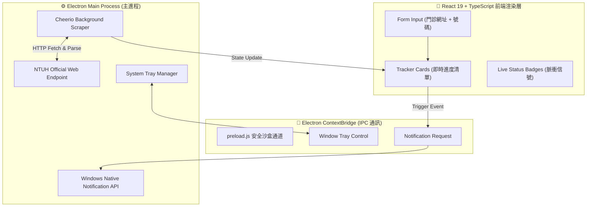

<div align="center">

# 🏥 NTUHNotifier2

**Enterprise-Grade Cross-Platform Desktop Queue Calling & Outpatient Notification System**

[](https://github.com/ian030590/NTUHNotifier2/stargazers)
[](https://opensource.org/licenses/MIT)
[](https://www.electronjs.org/)
[](https://react.dev/)
[](https://www.typescriptlang.org/)
[](https://vitejs.dev/)
[](https://github.com/ian030590/NTUHNotifier2/pulls)

<br />

<p align="center">
  
</p>

<p align="center">
  <b>基於 Electron + React 19 + TypeScript + Vite 打造的跨平台原生桌面版臺大醫院門診叫號追蹤與警報系統。</b>
</p>

</div>

---

## 📖 目錄 (Table of Contents)

- [產品簡介 (Overview)](#-產品簡介-overview)
- [核心優勢 (Key Highlights)](#-核心優勢-key-highlights)
- [系統架構 (System Architecture)](#-系統架構-system-architecture)
- [功能特點 (Feature Matrix)](#-功能特點-feature-matrix)
- [快速上手 (Quick Start)](#-快速上手-quick-start)
  - [1. 複製與安裝相依](#1-複製與安裝相依)
  - [2. 開發模式啟動](#2-開發模式啟動)
  - [3. 編譯封裝發行檔](#3-編譯封裝發行檔)
- [專案結構 (Directory Structure)](#-專案結構-directory-structure)
- [技術堆疊 (Tech Stack)](#-技術堆疊-tech-stack)
- [授權協議 (License)](#-授權協議-license)

---

## 🌟 產品簡介 (Overview)

**NTUHNotifier2** 是專為經常穿梭於國立臺灣大學醫學院附設醫院（NTUH）各臨床診間的臨床研究人員、醫師助理、實習醫學生與一般門診民眾設計的現代化桌面軟體。

不同於傳統網頁需持續保持分頁開啟，NTUHNotifier2 作為獨立原生桌面軟體，具備常駐 Windows 系統通知列（System Tray）、非同步 HTML 爬蟲解析、原生桌面彈出通知（Toast Notification）與聲音提示功能，讓使用者在專注臨床研究與辦公的同時，隨時精確掌握候診叫號脈動。

---

## ✨ 核心優勢 (Key Highlights)

- 🖥️ **獨立原生桌面常駐 (Native Desktop Integration)**：脫離瀏覽器記憶體消耗，支援最小化至系統工具列，不干擾日常工作。
- ⚡ **現代化前端架構 (React 19 & Vite)**：採用最新 React 19 框架搭配 Vite 超極速熱重載與 TypeScript 強型別安全。
- 🔍 **高效 DOM 萃取核心 (Cheerio Engine)**：內建高效率 DOM 解析管線，精準辨識「已報到」、「目前燈號」、「預計叫號」與「已叫最大號」。
- 🔔 **系統原生通知與音效 (Windows Toast & Audio)**：當目標號碼接近（提前 N 號）或已正式叫號時，直接呼叫作業系統原生通知 API 並發送音效。
- 🛡️ **隱私安全與離線本機處理**：所有門診進度皆直接由客戶端與臺大醫院官方伺服器安全通訊，無任何中繼伺服器收集使用者病患資料。

---

## 🏗️ 系統架構 (System Architecture)



---

## 📊 功能特點 (Feature Matrix)

| 功能模組 | 技術實現 | 使用體驗 |
| :--- | :--- | :--- |
| **多工診間管理** | React 狀態驅動模型 | 一鍵新增多個不同診間，各診獨立輪詢計時器 |
| **叫號狀態偵測** | 智能正規表達式 + DOM 樹分析 | 即時分辨「看診中」、「目前燈號」、「即將看診」 |
| **桌面推播通知** | Windows Toast Notification | 號碼接近或到達時即時浮現彈跳視窗，點擊直達 |
| **低資源消耗** | 輕量化計時輪詢架構 | 預設 60 秒定期微量請求，記憶體與 CPU 佔用極低 |

---

## 🚀 快速上手 (Quick Start)

### 1. 複製與安裝相依

確保本機已安裝 Node.js (建議 v18 以上)：

```bash
git clone https://github.com/ian030590/NTUHNotifier2.git
cd NTUHNotifier2
npm install
```

### 2. 開發模式啟動

同時啟動 Vite 前端伺服器與 Electron 主視窗：

```bash
npm run electron:start
```

### 3. 編譯封裝發行檔

打包建置 Windows 獨立可執行檔與安裝套件（MSI / EXE）：

```bash
npm run electron:build
```
打包完成後的二進位檔案將存放於 `dist-electron/win-unpacked/` 目錄中。

---

## 📁 專案結構 (Directory Structure)

```text
NTUHNotifier2/
├── assets/
│   └── screenshot.png         # 桌面端應用程式運行預覽展示圖
├── electron/
│   ├── main.js                # Electron 主行程生命週期與系統通知 IPC
│   └── preload.js             # 安全沙盒 Preload 橋接 API
├── src/
│   ├── App.tsx                # 主應用 React 介面、狀態邏輯與輪詢監控器
│   ├── main.tsx               # 前端程式進入點
│   └── style.css              # 現代化深淺色精緻 UI 樣式表
├── public/                    # 靜態資源與圖示 (icon.png)
├── package.json               # 專案相依套件與指令腳本
├── vite.config.ts             # Vite 建置配置
├── tsconfig.json              # TypeScript 編譯設定
└── README.md                  # 專案技術與使用說明文件
```

---

## 🛠️ 技術堆疊 (Tech Stack)

- **核心桌面框架**：Electron 42
- **使用者介面**：React 19, TypeScript
- **圖示函式庫**：Lucide React
- **建置工具**：Vite 8, Electron Builder
- **網路與爬蟲解析**：Cheerio, Fetch API

---

## 📄 授權協議 (License)

本專案採用 [MIT License](LICENSE) 授權開源。

<div align="center">
  <sub>Crafted with ❤️ by <a href="https://github.com/ian030590">Ian</a>.</sub>
</div>
